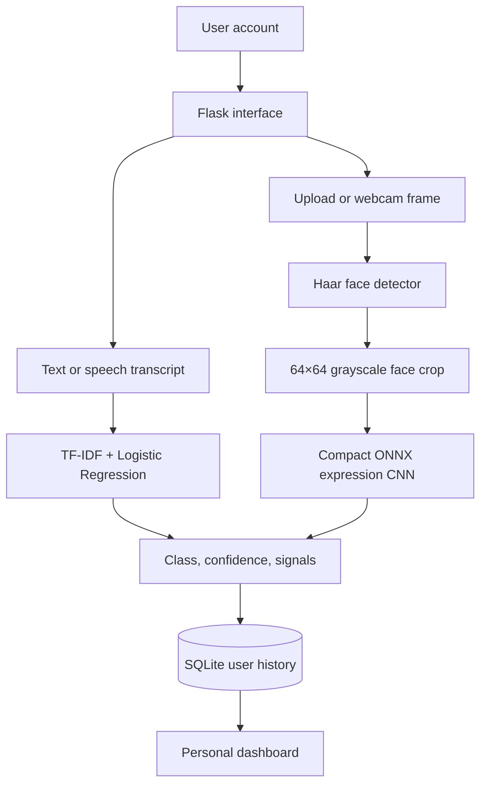

# MoodSense AI Local — Multimodal Edition

MoodSense AI Local is a complete local machine-learning project that analyses
emotional patterns from **typed text, transcribed speech, uploaded facial
photos, or webcam snapshots**. The Flask application runs only on the user's
computer, provides separate user accounts, and stores each user's multimodal
history in SQLite.

Two inference engines are included:

1. A TF–IDF and Logistic Regression pipeline for seven text classes: **Happy,
   Calm, Excited, Anxious, Sad, Angry, and Neutral**.
2. A compact ONNX CNN for seven visible facial-expression classes: **Angry,
   Disgust, Fear, Happy, Sad, Surprise, and Neutral**.

Both executed Jupyter notebooks, both model artifacts, all evaluation figures,
and all implementation source files are included.

## Important research boundary

The bundled text dataset contains **1,960 synthetic, curated demonstration
observations**—280 per mood. It is not a clinical or independently collected
dataset. Its perfect hold-out result reflects deliberately separable language
templates and must not be presented as unrestricted real-world accuracy.

The facial CNN is evaluated on all **3,589 images in the official FER-2013
PrivateTest split**. FER-2013 contains low-resolution, human-labelled face crops
from internet sources and does not represent every population or capture
condition. A visible expression is not direct proof of a person's internal
mood. The facial output must therefore be described as an expression-class
estimate rather than mind-reading or diagnosis.

MoodSense is a reflection tool and not a medical diagnosis, crisis service, or
substitute for a qualified professional.

## Main features

- Local Flask web application bound to `127.0.0.1`
- Registration, login, password hashing, sessions, and CSRF protection
- TF–IDF unigram/bigram text representation
- Comparison of Multinomial Naive Bayes, Logistic Regression, and SGD Log-Loss
- Two seven-class prediction engines with probability/confidence scores
- Influential word and phrase explanation
- Text input and browser speech-to-text input
- Uploaded JPG, PNG, or WEBP facial-expression analysis
- Live browser webcam snapshot capture
- OpenCV frontal-face detection and ONNX Runtime CNN inference
- Facial images processed in memory and not written to the database
- User-specific SQLite history and mood summaries
- Delete one record, clear history, or export history as CSV
- Urgent-support warning for explicit self-harm or harm language
- Responsive interface for desktop, tablet, and mobile
- Two executed `.ipynb` notebooks with real tables and plots
- Thirteen ready-to-use evaluation figures and five CSV result tables
- Automated text model, facial model, validation, safety, authentication, and
  user-isolation tests

## System architecture



The browser never supplies the record owner ID. Flask obtains the current user
from the signed session and applies that identity to all history queries and
deletions.

## Project structure

| Path | Purpose |
|---|---|
| `app.py` | Flask application, authentication, API, history, and CSV export |
| `database.py` | SQLite connection, schema, and initialization |
| `model_service.py` | Loads the trained pipeline and performs inference/explanation |
| `facial_service.py` | Validates images, detects faces, and runs the facial CNN |
| `infer_face.py` | Standalone command-line inference for one facial photo |
| `facial_evaluation.py` | Downloads/verifies FER-2013 and evaluates PrivateTest |
| `evaluate_facial_model.py` | Command-line facial evaluation and metadata export |
| `generate_dataset.py` | Reproducibly generates the balanced demonstration dataset |
| `train_model.py` | Trains, compares, evaluates, and saves candidate classifiers |
| `data/mood_text_dataset.csv` | Bundled 1,960-row labelled dataset |
| `models/mood_pipeline.joblib` | Selected trained pipeline used by Flask |
| `models/model_metadata.json` | Model name, metrics, classes, and evaluation metadata |
| `models/facial_expression_model.onnx` | Compact facial-expression CNN used by Flask |
| `models/facial_expression_model.tflite` | Original upstream quantized artifact retained for provenance |
| `models/haarcascade_frontalface_default.xml` | OpenCV frontal-face detector |
| `models/facial_model_metadata.json` | Official PrivateTest facial evaluation results |
| `notebooks/MoodSense_Model_Training_Evaluation.ipynb` | Executed evaluation notebook |
| `notebooks/MoodSense_Facial_Expression_Model_Evaluation.ipynb` | Executed facial CNN evaluation |
| `evaluation_outputs/` | Six figures, model table, report table, and text summary |
| `facial_evaluation_outputs/` | Seven figures, three CSV tables, and facial summary |
| `templates/` | Flask HTML pages |
| `static/css/styles.css` | Responsive interface styling |
| `static/js/app.js` | Text, speech, upload, webcam capture, and analysis requests |
| `tests/test_project.py` | Automated unit and integration tests |
| `scripts/build_notebook.py` | Regenerates and executes the notebook |
| `scripts/extract_notebook_outputs.py` | Exports notebook figures/tables for documentation |
| `scripts/build_facial_notebook.py` | Rebuilds and executes the facial notebook |
| `scripts/extract_facial_notebook_outputs.py` | Exports facial figures and tables |
| `THIRD_PARTY_NOTICES.md` | Model, detector, dataset, citation, and licence notices |

## Model evaluations included

### Text model evaluation

The supplied executed notebook produced the following prototype results:

| Item | Result |
|---|---:|
| Total observations | 1,960 |
| Training set | 1,568 (80%) |
| Test set | 392 (20%) |
| Test observations per class | 56 |
| Selected model | Logistic Regression |
| Test accuracy | 100.00% |
| Macro precision | 100.00% |
| Macro recall | 100.00% |
| Macro F1-score | 100.00% |
| Macro one-vs-rest ROC–AUC | 1.0000 |
| Five-fold CV macro F1 | 1.0000 ± 0.0000 |

The perfect score occurred because the synthetic language templates are highly
separable. The notebook explicitly discusses this limitation. For defensible
real-world research, replace the demonstration dataset with independently
collected, human-labelled text and perform external validation, fairness,
calibration, and error analyses.

### Suggested wording for your documentation

> The three candidate classifiers were trained using an identical TF–IDF
> unigram–bigram representation and evaluated on a stratified 20% hold-out set
> comprising 392 observations. Logistic Regression and the SGD log-loss model
> each obtained an accuracy and macro F1-score of 1.000, while Multinomial
> Naive Bayes obtained an accuracy and macro F1-score of approximately 0.997.
> Logistic Regression was retained as the deployment model because it matched
> the highest predictive performance while providing probabilistic outputs and
> interpretable linear feature coefficients. These results reflect a balanced,
> synthetically generated prototype dataset and therefore demonstrate technical
> feasibility rather than clinical or unrestricted real-world validity.

### Facial-expression model evaluation

The exact bundled ONNX CNN was evaluated without weight updates on all
3,589 FER-2013 `PrivateTest` images:

| Metric | Result |
|---|---:|
| Evaluation images | 3,589 |
| Accuracy | 64.42% |
| Balanced accuracy | 61.83% |
| Macro F1-score | 62.62% |
| Weighted F1-score | 64.28% |
| Macro one-vs-rest ROC–AUC | 0.9084 |
| Expected calibration error, 10 bins | 0.0766 |
| Mean prediction confidence | 72.08% |

Happy produced the strongest class F1-score (approximately 85.68%). Fear had
the weakest F1-score (approximately 45.01%), and the confusion matrix shows
notable overlap among fear, anger, sadness, and surprise. The model's mean
confidence is higher than its accuracy, so probability values should be
treated cautiously.

#### Suggested facial-model wording for your documentation

> The deployed ONNX CNN was evaluated on the official 3,589-image
> FER-2013 PrivateTest split and achieved 64.42% accuracy, 61.83% balanced
> accuracy, a macro F1-score of 62.62%, and a macro one-vs-rest ROC–AUC of
> 0.9084. Happy was the strongest class, while fear showed the lowest F1-score
> and substantial confusion with anger, sadness, and surprise. These results
> measure classification of visible facial patterns in FER-2013 face crops;
> they do not establish direct measurement of a person's internal mood or
> clinical state.

## Installation on macOS

### 1. Extract the source code

Unzip `MoodSense_Multimodal_Local_Source.zip` into a convenient location, such as
`Documents`.

### 2. Open Terminal in the project folder

```bash
cd "/Users/your-name/Documents/moodsense_local"
```

You can type `cd ` with a space and drag the folder into Terminal to insert the
correct path automatically.

### 3. Create a virtual environment

```bash
python3 -m venv .venv
```

### 4. Activate it

```bash
source .venv/bin/activate
```

Your Terminal prompt should now begin with `(.venv)`.

### 5. Install the dependencies

```bash
python -m pip install --upgrade pip
python -m pip install -r requirements.txt
```

### 6. Start the application

```bash
python app.py
```

Open this address in Chrome or Edge:

```text
http://127.0.0.1:5000
```

Create an account, sign in, and analyse text, speech, uploaded photos, or webcam
snapshots.

## Installation on Windows

Open PowerShell or Command Prompt inside the extracted project folder, then
run:

```powershell
py -m venv .venv
.venv\Scripts\activate
python -m pip install --upgrade pip
python -m pip install -r requirements.txt
python app.py
```

Open `http://127.0.0.1:5000` in Chrome or Edge.

## Both trained models are already included

You do **not** need to retrain the model before starting the app. The source
package contains:

- `models/mood_pipeline.joblib`
- `models/model_metadata.json`
- `models/facial_expression_model.onnx`
- `models/facial_expression_model.tflite` (provenance copy; not required at runtime)
- `models/haarcascade_frontalface_default.xml`
- `models/facial_model_metadata.json`

To deliberately regenerate the dataset and retrain all three models:

```bash
python generate_dataset.py
python train_model.py
```

The second command overwrites the saved pipeline with the best candidate from
that reproducible run.

The facial CNN is an ONNX conversion of the MIT-licensed quantized deployment
artifact distributed by the open-source `fer` project. ONNX Runtime makes the
same architecture portable across macOS, Windows, and Linux. The project
evaluates the deployed ONNX artifact and builds the local face-detection and
inference engine around it; it does not pretend to retrain the upstream CNN.
See `THIRD_PARTY_NOTICES.md` for attribution.

To rerun the official facial evaluation from Terminal:

```bash
python evaluate_facial_model.py
```

The first run downloads and checksum-verifies the FER-2013 archive
(approximately 92 MB). The dataset is cached in `data/fer2013_cache/` and is
excluded from the distributable source archive.

### Standalone facial inference without opening the web app

```bash
python infer_face.py "/path/to/photo.jpg"
python infer_face.py "/path/to/photo.jpg" --json
```

The command detects the largest frontal face and prints the leading expression,
confidence, number of detected faces, and seven-class probability distribution.

## Opening and rerunning the Jupyter notebook

Both notebooks are already executed; their tables and charts are embedded and
can be viewed immediately:

- `notebooks/MoodSense_Model_Training_Evaluation.ipynb`
- `notebooks/MoodSense_Facial_Expression_Model_Evaluation.ipynb`

### Option A: Visual Studio Code

1. Install the Python and Jupyter extensions in VS Code.
2. Open the project folder.
3. Open `notebooks/MoodSense_Model_Training_Evaluation.ipynb`.
4. Select the `.venv` Python interpreter if you want to rerun it.

### Option B: JupyterLab

Install the optional notebook dependencies:

```bash
python -m pip install -r requirements-notebook.txt
jupyter lab
```

Open the notebook from the JupyterLab file browser and choose **Run All**.

### Regenerate the executed notebook from Terminal

```bash
python scripts/build_notebook.py
python scripts/extract_notebook_outputs.py
python scripts/build_facial_notebook.py
python scripts/extract_facial_notebook_outputs.py
```

Each builder runs every notebook cell sequentially and fails if any cell raises
an error. The extraction scripts export the figures and metric tables to
`evaluation_outputs/` and `facial_evaluation_outputs/`.

## Evaluation materials for Chapter Four

The following are ready to insert into documentation:

- `figure_1_class_distribution.png`
- `figure_2_model_comparison.png`
- `figure_3_confusion_matrix.png`
- `figure_4_multiclass_roc_curves.png`
- `figure_5_per_class_metrics.png`
- `figure_6_influential_features.png`
- `table_1_model_comparison.csv`
- `table_2_classification_report.csv`
- `evaluation_summary.txt`

All are located in `evaluation_outputs/`.

The facial-model materials are located in `facial_evaluation_outputs/`:

- `facial_figure_1_class_distribution.png`
- `facial_figure_2_sample_faces.png`
- `facial_figure_3_confusion_matrix.png`
- `facial_figure_4_per_class_metrics.png`
- `facial_figure_5_multiclass_roc_curves.png`
- `facial_figure_6_reliability_diagram.png`
- `facial_figure_7_high_confidence_errors.png`
- `facial_table_1_classification_report.csv`
- `facial_table_2_overall_metrics.csv`
- `facial_table_3_confusion_matrix.csv`
- `facial_evaluation_summary.txt`

## Run the automated tests

From the activated virtual environment:

```bash
python -m unittest discover -s tests -v
```

The tests verify:

- A representative sentence for all seven mood classes
- Probability normalization
- The seven-output facial CNN and probability normalization
- Image data URL validation
- The urgent-support language flag
- Registration and login
- Saving text and facial predictions
- Confirming raw facial image bytes are not stored in SQLite
- Separation of one user's records from another user's dashboard

## How the implementation works

### Text and speech route

1. The user types text or the browser converts speech into a text transcript.
2. JavaScript sends the text to `/api/analyze` with the session's CSRF token.
3. Flask validates the length and obtains the user identity from the session.
4. The saved scikit-learn pipeline converts the text to TF–IDF features.
5. Logistic Regression returns a mood and probability distribution.
6. `model_service.py` extracts influential terms and checks explicit urgent
   support phrases.

### Facial route

1. The user uploads a supported photo or captures one webcam frame.
2. The browser converts it to an image data URL and sends it to
   `/api/analyze-face` with the CSRF token.
3. Flask limits the request and `facial_service.py` validates format, encoded
   size, decoded image, and image resolution.
4. OpenCV detects frontal faces; the largest detected face is selected and
   expanded into a square crop.
5. The crop is grayscale, resized to 64 × 64, normalized to `[-1, 1]`, and
   sent to the compact CNN through ONNX Runtime.
6. The CNN returns seven probabilities and the leading visible-expression
   class.
7. Flask saves only the textual source summary, prediction, confidence,
   probabilities, and user ID. It does **not** save the submitted image.

The dashboard combines both modalities into one private timeline and summary.

## Database implementation

The database is created automatically as `instance/moodsense.db` the first time
the application starts. It contains:

- `users`: name, unique email, password hash, and creation date
- `mood_records`: user ID, input summary, input method, predicted mood, confidence,
  probabilities, and date

Deleting a user at database level cascades to that user's mood records. History
queries, single deletions, and full-history deletion always include the signed
user's ID.

## Speech input note

The Flask server, model inference, and SQLite records run locally. Speech input
uses the browser's Web Speech API. Chrome or Edge may use the browser vendor's
online speech-recognition service, so microphone transcription is not
guaranteed to be offline. Typed-text analysis remains fully local.

## Camera and facial-image privacy

The browser requests camera permission only after the user clicks **Start
camera**. A single frame is submitted only after **Capture photo** and
**Analyse**. Uploaded or captured image bytes are decoded and processed in
memory, then discarded. SQLite receives no raw image, filename, biometric
template, or camera stream. The history stores only a statement that an image
was analysed, its source (`face_camera` or `face_upload`), predicted class,
confidence, probabilities, and date.

The webcam works on `http://127.0.0.1` or `http://localhost` in modern browsers.
Camera access may be blocked if the browser or operating system permission is
disabled.

## Security and deployment note

This version is deliberately configured for local use and binds only to
`127.0.0.1`. Before exposing it to a network or the internet, add a production
WSGI server, HTTPS, secure environment-managed secrets, rate limiting, email
verification, password recovery, backup controls, logging, and a formal privacy
policy. Because photographs can be sensitive personal data, any networked
version also requires explicit consent, retention rules, access auditing,
encryption, and applicable privacy-law review.

For local use, create a strong secret key before starting:

```bash
export SECRET_KEY="replace-this-with-a-long-random-value"
python app.py
```

On Windows PowerShell:

```powershell
$env:SECRET_KEY="replace-this-with-a-long-random-value"
python app.py
```

## Common troubleshooting

### `python3: command not found`

Install Python 3.11 or newer from Python.org, then reopen Terminal.

### `No module named flask`

The virtual environment is not active or dependencies were not installed:

```bash
source .venv/bin/activate
python -m pip install -r requirements.txt
```

### `The trained model is missing`

Run:

```bash
python generate_dataset.py
python train_model.py
```

If the facial engine reports missing assets, verify that these files exist:

```text
models/facial_expression_model.onnx
models/haarcascade_frontalface_default.xml
```

Re-extract the complete source archive if either file is absent.

### Microphone button does not transcribe

- Use Chrome or Edge.
- Allow microphone access when the browser asks.
- Check the operating system microphone permission for the browser.
- Use typed input if speech recognition is unavailable.

### No face was detected

- Use one clear, front-facing face.
- Improve the lighting and keep the whole face inside the frame.
- Remove sunglasses or anything covering the eyes and mouth.
- Move closer if the face is very small.
- Try a JPG or PNG photo if the webcam frame remains unclear.

### Camera permission was denied

Allow camera access for `127.0.0.1` in the browser's site settings and confirm
that Chrome or Edge has camera permission in the operating system settings.
You can always use **Upload photo** instead.

### Port 5000 is already in use on macOS

Run Flask on another port:

```bash
python -m flask --app app run --port 5050
```

Then open `http://127.0.0.1:5050`.

## Extending the project with real datasets

### Text data

Prepare a CSV file with exactly these columns:

```text
text,mood
```

Allowed labels are `happy`, `calm`, `excited`, `anxious`, `sad`, `angry`, and
`neutral`. Replace `data/mood_text_dataset.csv`, then run `python
train_model.py`. For research use, document the source, consent or licence,
annotation protocol, inter-rater agreement, demographic coverage, missing-data
handling, class distribution, and ethical approval.

### Facial-expression data

The evaluation helper expects the original FER-2013 CSV structure:

```text
emotion,pixels,Usage
```

For a new dataset, create a separate evaluation or training pipeline that maps
labels explicitly to the seven deployment classes. Document participant
consent, dataset licence, image acquisition, annotator instructions,
inter-rater agreement, age/sex/skin-tone/geographic coverage, face-detection
failure rate, class imbalance, augmentation, person-independent splits, and
external validation. Never place images from the same individual in both the
training and test partitions.

## Citation

For the FER-2013 benchmark, cite:

Goodfellow, I. J., et al. (2013). Challenges in representation learning: A
report on three machine learning contests. *Neural Information Processing*,
117–124. https://doi.org/10.1007/978-3-642-42051-1_16

See `THIRD_PARTY_NOTICES.md` for model and detector licensing information.
